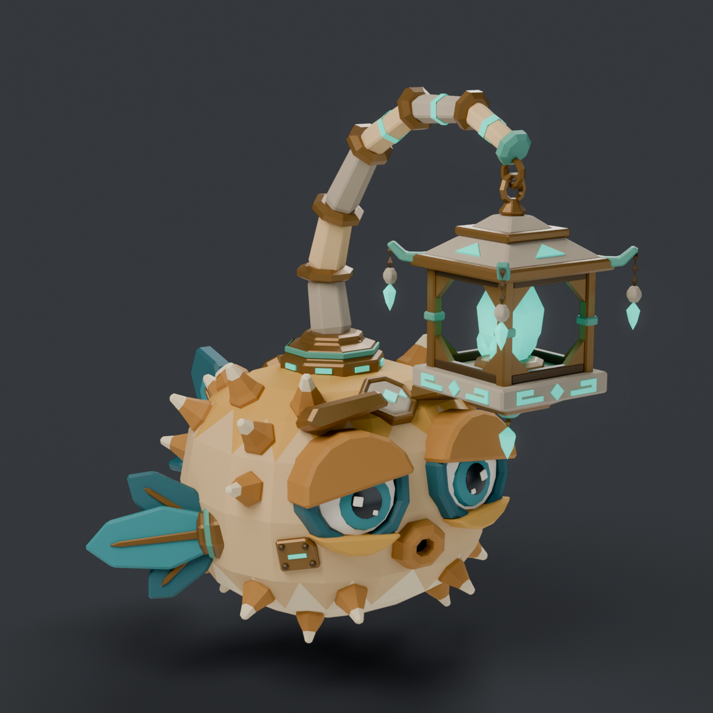
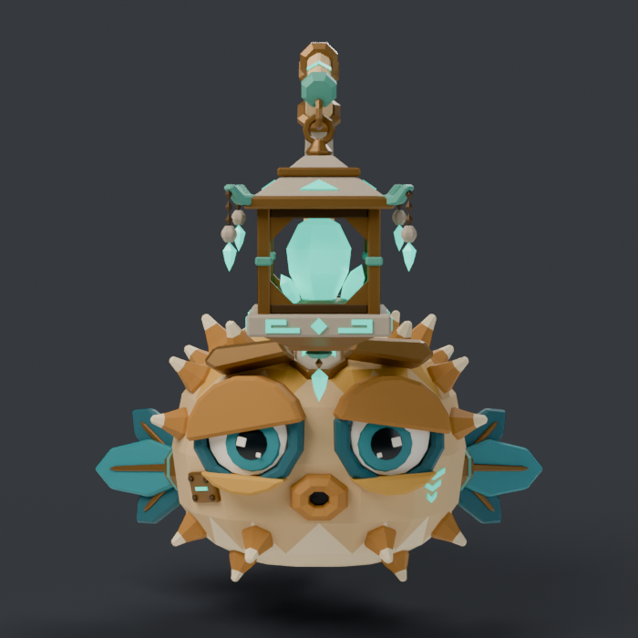
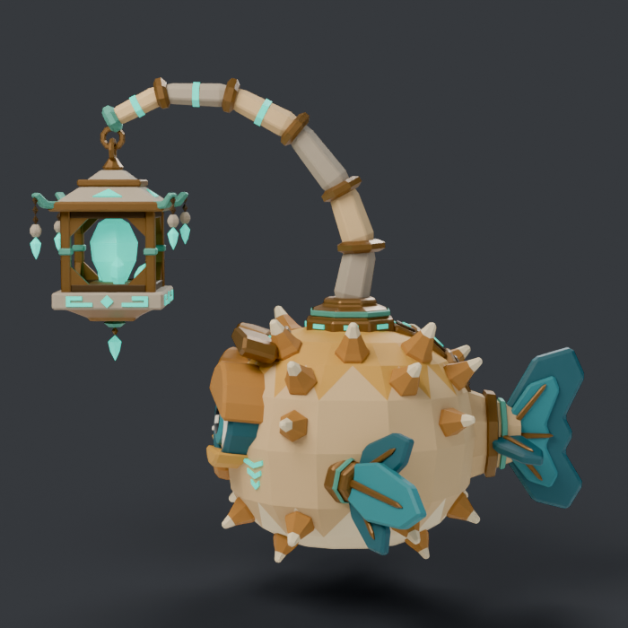
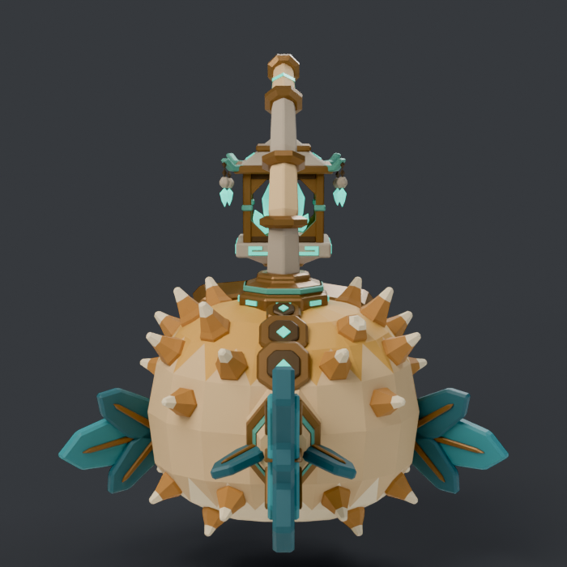

# Ancient Lantern Blowfish

A stylized, blocky Roblox pet: a sandstone-and-bronze blowfish from a forgotten
underwater civilization, carrying an ancient crystal lantern on a segmented stalk.

| Front | Side | Rear |
| --- | --- | --- |
|  |  |  |

Extra QA angles: `renders/three_quarter_rear.png`, `renders/top_down.png`.

## Files

| File | Purpose |
| --- | --- |
| `AncientLanternBlowfish.blend` | Blender source (saved from Blender 5.0.1), organized in `ALB_*` collections |
| `AncientLanternBlowfish.fbx` | Roblox Studio import (triangulated, meshes only) |
| `AncientLanternBlowfish.glb` | Quick inspection in any glTF viewer |
| `build_blowfish.py` | Rebuilds the model and all exports from scratch with `bpy` |
| `render_previews.py` | Cycles studio renders into `renders/` |
| `stats.json` | Per-object vertex / triangle counts and bounds |

Rebuild: `python build_blowfish.py && python render_previews.py` with a Python that
has the `bpy` module (`pip install bpy pillow` on Python 3.11).

## Design summary

- **Body** - custom faceted squircle lattice (not a sphere): flat top and bottom caps,
  flatter belly, slight taper to the tail, and two sawtooth colour bands
  (pale belly, sandstone middle, ochre crown) cut into the mesh itself.
- **Spikes** - 28 short hexagonal two-tone spikes seated one per facet in staggered
  rows; the face, fins, tail and back armour are kept clear. One is chipped.
- **Face** - large eyes with teal sockets, iris, pupil and square glints; thick angular
  ochre lids, bronze brows and a small protruding "o" mouth, all real geometry.
  The left eye droops slightly more and the right brow sits higher.
- **Lantern** - four-post bronze frame with angular gussets, stepped stone-and-bronze
  roof with upturned patina eaves, stone base with engraved meander motifs, a large
  faceted crystal with three satellite shards, a bottom pendant and four bead-and-shard
  danglers (the front pair hangs longer). It hangs from interlinked rings on a
  seven-knuckle stalk, clear of the body.
- **Fins and tail** - three-plate layered side fins with bronze ribs and shoulder cuffs;
  a short, broad notched tail with a raised inner layer, bronze rings on the stem and
  two swept side flukes for the rear silhouette.
- **Ornaments** - stepped bronze crown seating the stalk, three overlapping back scutes,
  a carved forehead medallion, a chevron glyph on the right cheek and a riveted bronze
  repair plate on the left.

## Technical statistics

- 37 mesh objects, one material each, 12,174 triangles in total
  (largest single mesh about 1,300 triangles).
- Size about 4.0 x 4.9 x 4.3 units (width x length x height); 1 unit is intended as 1 stud.
- Origin at the ground plane under the body centre; all object transforms are identity.
- Z up, the fish faces -Y in Blender.
- 14 flat-colour Principled materials, no textures. Two are emissive
  (`ALB_Crystal_Glow`, `ALB_Inlay_Glow`).
- Every mesh has a Smart UV Project layer in case textures are applied later.
- Flat shading with chamfered edges; only the eyeballs use smooth shading.
- Objects are named `ALB_<Region>_<Material>`; regions are Body, Face, Spikes, Fins,
  Tail, Ornaments, Stalk and Lantern.

Checked by script: no loose vertices, wire edges, zero-area faces or missing materials
in the .blend, and the FBX and GLB re-import into Blender with the same 37 meshes,
12,174 triangles and bounds.

## Roblox Studio import guide

The import below has not been run in Roblox Studio from this environment, so verify
scale and facing in the importer preview.

1. Open **Home > Import 3D** (the 3D Importer) and choose `AncientLanternBlowfish.fbx`.
2. In the importer, keep the file as a single **Model**, turn **Anchored** on for
   placement, and check the preview size: it should be about 4 x 4.3 x 4.9 studs.
   If it comes in 100 times too large or small, change the importer's scale unit.
3. Import. Each `ALB_*` object becomes one MeshPart. Colours do not rely on textures,
   so set **Color** and **Material** per MeshPart by the name suffix:

   | Suffix | Color (hex) | Suggested Material |
   | --- | --- | --- |
   | `Sandstone` | `#D2B180` | Sandstone or SmoothPlastic |
   | `Sand_Light` | `#ECDBB4` | Sandstone or SmoothPlastic |
   | `Ochre` | `#C9973F` | SmoothPlastic |
   | `Ochre_Dark` | `#A9742F` | SmoothPlastic |
   | `Stone` | `#A39683` | Slate or SmoothPlastic |
   | `Bronze` | `#7C5A2E` | Metal |
   | `Bronze_Dark` | `#4A3821` | Metal |
   | `Patina` | `#4F9C88` | CorrodedMetal or Metal |
   | `Teal_Deep` | `#155560` | SmoothPlastic |
   | `Teal_Mid` | `#238088` | SmoothPlastic |
   | `Crystal_Glow`, `Inlay_Glow` | `#12DCC4` | Neon |
   | `Eye_White` | `#F6F0E0` | SmoothPlastic |
   | `Eye_Black` | `#0E1518` | SmoothPlastic (Reflectance about 0.2) |

4. For a pet: set `ALB_Body_Sandstone` as the Model's **PrimaryPart**, weld the other
   parts to it (WeldConstraints), then unanchor all but the root as your pet system
   requires. Set **CanCollide** off and **CollisionFidelity** to Box on every part.
5. Optional polish: add a turquoise **PointLight** (Range about 10, Brightness about 1.5)
   to `ALB_Lantern_Crystal_Glow`, and turn **CastShadow** off on the Neon parts.
6. The `ALB_Lantern_*` and `ALB_Stalk_*` parts are separate from the body, so the
   lantern can be welded to its own pivot and swung with a Motor6D or a tween.

## Preview render notes

Renders use Cycles with a three-light studio rig and a shadow-catcher floor. A soft
bloom is added in post only around the turquoise emitters; the geometry is unaffected.
